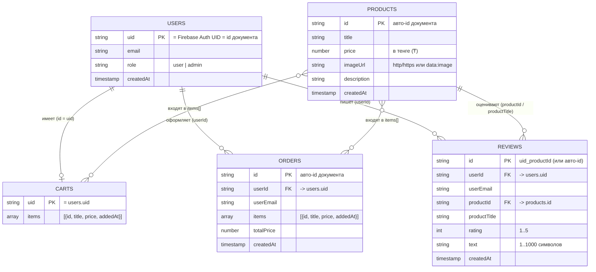

# Схема базы данных — ЖЕЛЕЗОПК

База: **Cloud Firestore** (NoSQL, документы в коллекциях). Авторизация — Firebase Authentication (email + пароль).
Правила доступа лежат в [`firestore.rules`](firestore.rules).

## ER-диаграмма

## Коллекции

### `users`
Профиль пользователя. Создаётся при регистрации (`js/auth.js`).

| Поле | Тип | Описание |
|------|-----|----------|
| `uid` | string | UID из Firebase Auth (он же id документа) |
| `email` | string | Почта |
| `role` | string | `user` или `admin` |
| `createdAt` | timestamp | Дата регистрации |

Роль `admin` выдаётся только вручную в консоли Firebase.

### `products`
Каталог товаров. Добавляет и удаляет только админ (`js/admin.js`).

| Поле | Тип | Описание |
|------|-----|----------|
| `title` | string | Название |
| `price` | number | Цена в ₸ (> 0) |
| `imageUrl` | string | Ссылка на картинку |
| `description` | string | Описание |
| `createdAt` | timestamp | Дата добавления |

### `carts`
Корзина. Один документ на пользователя, id = `uid`.

| Поле | Тип | Описание |
|------|-----|----------|
| `items` | array | Список `{ id, title, price, addedAt }` |

### `orders`
Покупки. После оформления корзина очищается.

| Поле | Тип | Описание |
|------|-----|----------|
| `userId` | string | Кто купил (`users.uid`) |
| `userEmail` | string | Почта покупателя |
| `items` | array | Снимок товаров на момент покупки |
| `totalPrice` | number | Сумма заказа |
| `createdAt` | timestamp | Дата заказа |

### `reviews`
Отзывы. Пишутся только из личного кабинета (`js/profile.js`).

| Поле | Тип | Описание |
|------|-----|----------|
| `userId` | string | Автор (`users.uid`) |
| `userEmail` | string | Почта автора (на сайте маскируется) |
| `productId` | string | Товар (`products.id`) |
| `productTitle` | string | Название товара (по нему считается рейтинг) |
| `rating` | int | Оценка 1–5 |
| `text` | string | Текст, 1–1000 символов |
| `createdAt` | timestamp | Дата отзыва |

Id документа = `{uid}_{productId}`, поэтому один пользователь может оставить на товар только один отзыв.

## Права доступа

| Коллекция | Чтение | Создание | Изменение / удаление |
|-----------|--------|----------|----------------------|
| `users` | свой документ, админ — все | только свой, `role = user` | нельзя |
| `products` | все | админ | админ |
| `carts` | только своя | только своя | только своя |
| `orders` | свои, админ — все | только от своего имени | нельзя |
| `reviews` | все | авторизованный, от своего имени | нельзя |

## Связи

- `users` 1 — 1 `carts` (id корзины = uid)
- `users` 1 — N `orders`
- `users` 1 — N `reviews`
- `products` 1 — N `reviews`
- `orders.items` и `carts.items` хранят копию товара (id, название, цену), а не ссылку — цена в заказе не меняется, даже если товар поменяют.
